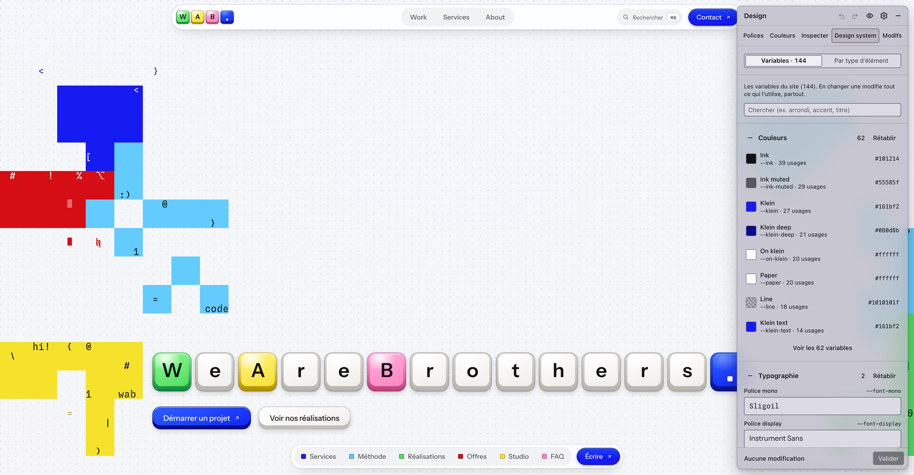

# wabdesign

Un panneau de design qui s’ouvre par-dessus la preview locale de ton site (`localhost:3000`,
`localhost:5173`…). Tu y changes les polices, les couleurs, les variables du design system,
les espacements, les arrondis et les textes, et tu vois le résultat tout de suite dans la page.
Quand le résultat te plaît, « Valider » demande à [Claude Code](https://claude.com/claude-code)
de reporter les modifications dans le code du projet.



Conçu pour travailler avec Claude Code : tu lui demandes un site, il lance la preview, tu tapes
`/wabdesign`, tu ajustes le design à la main, il l’applique dans le code.

## Ce que fait le panneau

| Onglet | Pour quoi faire |
|---|---|
| **Polices** | Choisir la police des titres, du texte courant et des boutons, parmi tes propres fichiers de polices et le catalogue Google Fonts. Graisse, italique, axes des polices variables, interligne, interlettrage. Enregistrer des combinaisons, ou en tirer une au sort parmi tes favoris. |
| **Couleurs** | Créer des palettes (coller des codes couleur ou un lien coolors.co), puis remplacer n’importe quelle couleur du site, partout, y compris au survol. |
| **Inspecter** | Cliquer sur un élément de la page et régler son texte, sa police, ses couleurs, son arrondi, ses marges. Pour cet élément seul, pour les éléments semblables, ou pour tous les éléments du même type. |
| **Design system** | Toutes les variables CSS du site, rangées par familles (couleurs, typographie, arrondis, espacements, ombres). En changer une change tout ce qui l’utilise. |
| **Modifs** | La liste de tout ce que tu as changé, avec un bouton pour retirer chaque modification, puis « Valider ». |

Rien ne touche ton code tant que tu n’as pas cliqué sur « Valider ». Tes essais sont gardés
si tu recharges la page ou relances l’outil.

## Installation

Il faut [Node.js](https://nodejs.org) 20 ou plus récent.

```bash
npm install -g https://github.com/Lazizze-git/wabdesign/releases/latest/download/wabdesign.tgz
wabdesign setup
```

La première commande installe l’outil. La seconde ajoute la commande `/wabdesign` à Claude Code.
Ouvre ensuite une nouvelle conversation Claude Code pour qu’elle apparaisse.

## Utilisation

### Depuis Claude Code (le plus simple)

Dans la conversation de ton projet, tape :

```
/wabdesign
```

Claude trouve la preview du projet (et la lance si elle ne tourne pas), puis ouvre le panneau
dans ton navigateur. `/wabdesign 3000` vise la preview d’un port précis, `/wabdesign stop` ferme le panneau.

### Depuis un terminal

Lance ta preview comme d’habitude (`npm run dev`), puis, **dans le dossier du projet** :

```bash
wabdesign          # trouve la preview lancée depuis ce dossier
wabdesign 3000     # ou indique son port
```

Le navigateur s’ouvre sur `http://localhost:4000` : c’est ta page, avec le panneau par-dessus.
Utilise bien cette adresse, et non celle de la preview seule. Le rechargement automatique
de ton serveur de développement continue de fonctionner.

### Raccourcis

| Raccourci | Action |
|---|---|
| ⌥ D (Alt + D) | Afficher ou cacher le panneau |
| ⌥ S (Alt + S) | Cliquer un élément de la page pour le modifier |
| ⌥ A (Alt + A), maintenu | Voir le site d’origine, sans tes modifications |
| ⌘ Z / ⇧ ⌘ Z (Ctrl + Z / Ctrl + Maj + Z) | Annuler / rétablir |

Le panneau se déplace en tirant son en-tête, et se réduit en pastille avec le bouton –.

## Tes polices

Dans les réglages du panneau (roue dentée), ajoute un ou plusieurs dossiers de polices
(`.otf`, `.ttf`, `.woff`, `.woff2`, sous-dossiers compris). Sur Mac, le bouton « Choisir un
dossier » ouvre le Finder. Un dossier Google Drive synchronisé sur l’ordinateur fonctionne
comme un dossier normal. Le catalogue Google Fonts est disponible en plus, et peut être désactivé.

Ces réglages, tes palettes, tes favoris et tes combinaisons sont communs à tous tes projets
(`~/.config/outil-design/`).

## Valider : ce qui se passe

1. L’outil écrit une fiche qui décrit chaque modification (élément visé, ancienne et nouvelle
   valeur), dans le dossier `.design-tool/` du projet. Ce dossier s’ignore lui-même dans Git.
2. Il lance Claude Code dans le projet avec cette fiche. Claude modifie la source de chaque valeur
   (variable, thème Tailwind, composant), copie les polices locales utilisées dans le projet, et
   ne touche à rien d’autre. Tu suis son travail dans le panneau.
3. Sans Claude Code, « Enregistrer seulement la fiche » produit le même document, à donner à
   l’outil de ton choix.

Conseil : sauvegarde ton projet avec Git avant de valider, pour pouvoir revenir en arrière.

## Confidentialité et sécurité

- Tout tourne sur ton ordinateur. Le relais n’écoute que sur `127.0.0.1` et refuse les demandes
  venant d’autres sites ouverts dans ton navigateur.
- Le seul accès à internet est le catalogue et les fichiers de Google Fonts (désactivable).
- « Valider » lance Claude Code avec ton compte, limité à la lecture et à l’écriture de fichiers
  dans le projet, et à la copie des polices.

## Limites connues

- Les sites qui écrivent leurs valeurs en dur, sans variables CSS, n’ont rien dans l’onglet
  Design system : on passe alors par Inspecter et « Par type d’élément ».
- Avec Tailwind 4 en mode `@theme inline`, modifier une variable ne change pas l’affichage :
  les valeurs sont recopiées dans les classes.
- Le choix d’un dossier par le Finder n’existe que sur macOS. Ailleurs, on colle le chemin du dossier.
- L’interface du panneau est en français.

## Mettre à jour, désinstaller

```bash
# mettre à jour (même commande que l’installation)
npm install -g https://github.com/Lazizze-git/wabdesign/releases/latest/download/wabdesign.tgz

# désinstaller
npm uninstall -g wabdesign
rm -rf ~/.claude/skills/wabdesign
```

## Contribuer

```bash
git clone https://github.com/Lazizze-git/wabdesign.git
cd wabdesign
npm install
npm run dev      # recompile à chaque modification
npm run check    # types, règles de code, tests
npm run build    # régénère dist/ (à inclure dans le commit)
```

Publier une version : monter `version` dans `package.json`, `npm run build`, commit, puis
`npm pack` et joindre le fichier renommé `wabdesign.tgz` à une release GitHub (`gh release create vX.Y.Z wabdesign.tgz`).

Le code est en TypeScript : le serveur relais dans `src/server`, le panneau (Preact, dans un
Shadow DOM) dans `src/client`. Les choix visuels du panneau sont expliqués dans `DESIGN.md`.

## In English

wabdesign overlays a design panel on your local dev preview. Try fonts (your own files or
Google Fonts), colors, design-system CSS variables, spacing, radius and copy live, then click
« Valider » to have Claude Code apply the changes to your source code. Install with
`npm install -g https://github.com/Lazizze-git/wabdesign/releases/latest/download/wabdesign.tgz && wabdesign setup`, then type `/wabdesign` in
Claude Code or run `wabdesign` in your project folder. The panel UI is in French.

## Licence

MIT, voir [LICENSE](LICENSE).
